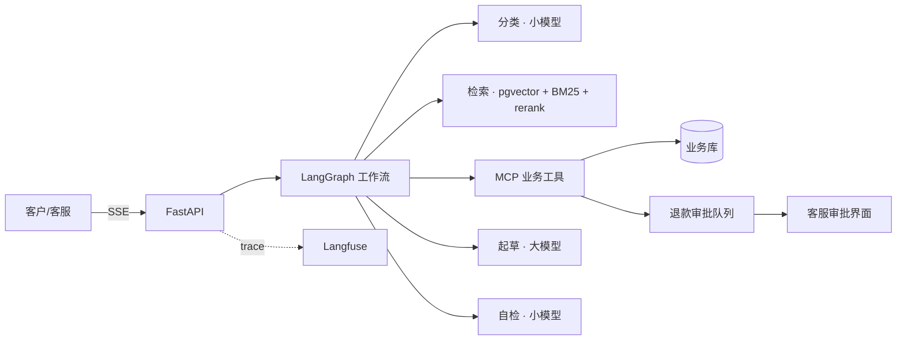

## 今天要解决的问题

SupportPilot 做完了,在公网上跑着,有评测、有 trace、有成本账本、有安全测试。如果你现在把仓库链接发给一个面试官,他大概率会看到一个默认生成的 README,三行字加一句 `uv run python -m app.api`,然后关掉页面。

这不是夸张。我自己做面试官筛简历的时候,一份简历平均看一两分钟,简历上的 GitHub 链接只有在简历本身让我感兴趣时才会点,点进去如果第一屏看不出这个项目在干什么、做得怎么样,就不会往下翻了。你花了 12 天做的东西,能不能被看见,取决于今天这几个小时。

今天结束时你应该有:

1. 一份重写过的 README,第一屏就能回答「这是什么、能看演示吗、做得怎么样」。
2. 一张架构图,放在 README 里,GitHub 上能直接渲染。
3. 一段 2–3 分钟的演示视频,传到 B 站和 YouTube,README 和简历里都能放链接。
4. 一篇技术博客的完整初稿,讲清楚三个真实的踩坑和你用来证明「改好了」的数字。
5. 整理好的 GitHub 主页:置顶仓库、个人简介、没有泄露密钥的提交历史。

预计用时 6–8 小时,其中录视频和写博客最花时间。前置是 Day 43 的需求文档、Day 50–53 的评测记录、成本记录和安全测试结果,今天要用到里面的每一个数字。

## 面试官的 5 分钟

先站到对面去想。一个招 AI Agent 工程师的面试官,点开你的仓库后通常按这个顺序看,每一步都可能是最后一步:

<figure>
<svg viewBox="0 0 640 210" role="img" aria-label="面试官浏览作品的五分钟时间线">
  <rect x="0" y="0" width="640" height="210" fill="var(--paper-raised)"/>
  <line x1="30" y1="100" x2="610" y2="100" stroke="var(--rule)" stroke-width="2"/>
  <circle cx="40" cy="100" r="6" fill="var(--mem)"/>
  <text x="22" y="80" font-family="var(--font-mono)" font-size="11" fill="var(--ink)">0:00</text>
  <text x="22" y="128" font-family="var(--font-mono)" font-size="12" fill="var(--ink)">一句话</text>
  <text x="22" y="144" font-family="var(--font-mono)" font-size="11" fill="var(--ink-soft)">在干什么</text>
  <circle cx="150" cy="100" r="6" fill="var(--mem)"/>
  <text x="132" y="80" font-family="var(--font-mono)" font-size="11" fill="var(--ink)">0:15</text>
  <text x="122" y="128" font-family="var(--font-mono)" font-size="12" fill="var(--ink)">GIF/视频</text>
  <text x="122" y="144" font-family="var(--font-mono)" font-size="11" fill="var(--ink-soft)">真的能跑吗</text>
  <circle cx="270" cy="100" r="6" fill="var(--mem)"/>
  <text x="252" y="80" font-family="var(--font-mono)" font-size="11" fill="var(--ink)">1:00</text>
  <text x="242" y="128" font-family="var(--font-mono)" font-size="12" fill="var(--ink)">关键数字</text>
  <text x="242" y="144" font-family="var(--font-mono)" font-size="11" fill="var(--ink-soft)">做得怎么样</text>
  <circle cx="400" cy="100" r="6" fill="var(--compute)"/>
  <text x="382" y="80" font-family="var(--font-mono)" font-size="11" fill="var(--ink)">2:00</text>
  <text x="372" y="128" font-family="var(--font-mono)" font-size="12" fill="var(--ink)">架构+取舍</text>
  <text x="372" y="144" font-family="var(--font-mono)" font-size="11" fill="var(--ink-soft)">会不会想</text>
  <circle cx="540" cy="100" r="6" fill="var(--compute)"/>
  <text x="522" y="80" font-family="var(--font-mono)" font-size="11" fill="var(--ink)">3:30</text>
  <text x="512" y="128" font-family="var(--font-mono)" font-size="12" fill="var(--ink)">代码抽查</text>
  <text x="512" y="144" font-family="var(--font-mono)" font-size="11" fill="var(--ink-soft)">测试·CI·提交</text>
  <text x="30" y="186" font-family="var(--font-mono)" font-size="11" fill="var(--ink-faint)">蓝色三步决定他会不会继续看;琥珀色两步决定面试时问你什么</text>
</svg>
<figcaption>一个面试官浏览作品的大致顺序(按我和身边几位面试官的习惯总结,不是统计数据)。README 的结构应该照着这个顺序排。</figcaption>
</figure>

几个推论:

- 第一句话必须说清楚问题和对象,不要写「一个基于 LangGraph 的智能 Agent 系统」这种谁都能写的话。写「给 SaaS 客服团队用的工单 Agent:自动查账单、带引用起草回复,退款走人工审批」。
- 演示要在第一屏,GIF 最好,因为它不用点就会动。视频链接放在 GIF 下面。
- 数字要在第一屏。招聘方最想区分的就是「跟着教程搭了个 demo」和「知道怎么证明自己的 Agent 好用」,而能区分两者的就是评测分数、成本、延迟这些数字,以及你怎么测出来的。
- 架构和取舍决定面试时被问什么。你在 README 里写了「为什么起草用大模型、分类用小模型」,面试官多半会顺着这个问,这正是你准备得最充分的地方。把面试的话题引到自己的主场,是 README 最被低估的作用。

## README 模板

下面是一个可以直接改的模板。所有带尖括号的地方换成你自己的内容,所有数字都从 Day 50–53 的记录表里抄,没有测过的数字宁可空着,也不要估一个看上去好看的。

````markdown
# SupportPilot

给 SaaS 客服团队用的工单 Agent:自动分类工单、检索帮助中心、查询客户账单,
起草带引用的回复;退款等敏感操作只能申请,由客服人工审批后执行。

**在线演示**:<https://demo.your-domain.com>(演示账号见下方,数据全部为虚构)
**演示视频**:[B 站](<链接>) · [YouTube](<链接>)(2 分 40 秒)


## 结果一览

| 指标 | 数值 | 怎么测的 |
| --- | --- | --- |
| 端到端任务成功率 | <xx>% | 100 条测试工单,规则断言 + LLM 评审,见 evals/ |
| 回复引用正确率 | <xx>% | 人工抽检 30 条 + judge 一致率 <xx>% |
| 注入攻击成功率 | 越权 0/<n>,绕过审批 0/<n>,总计 <x>/<n> | evals/injection_cases.jsonl |
| P95 延迟 | <x.x> s | 评测集全量跑,不含首次冷启动 |
| 单工单成本 | 平均 ¥<0.0xx>,P95 ¥<0.0xx> | 自建账本,DeepSeek 2026-10 价格 |

## 架构



## 设计决策

- **为什么用 LangGraph 而不是手写循环**:<你的理由,一两句>
- **为什么分类和自检用小模型**:<数据:换小模型后分数变化 x,成本降低 y>
- **为什么退款只能申请不能执行**:<安全理由 + 注入测试结果>
- **没有做语义缓存**:<原因>

## 评测

<一段话说明测试集构成、三层评测怎么做、怎么在 CI 里跑。放一张分数随迭代变化的表。>

## 本地运行

```bash
git clone <repo> && cd supportpilot
cp .env.example .env   # 填 LLM_API_KEY 等
docker compose up -d --build
docker compose exec api python data/seed_db.py && docker compose exec api python rag/ingest.py
# 浏览器打开 localhost
```

## 目录

<贴 Day 52 的目录树,每个目录一句说明>

## 已知局限

- <注入测试里还有哪几类残留,为什么>
- <哪类工单分数最低,原因猜测>
- <没做的事:多语言、语音、真实支付网关等>
````

外层用了四个反引号,是因为模板里面嵌套了代码块,复制的时候注意。

几个写 README 时我反复犯过的错:

**把安装步骤放在最前面。** 面试官不会装,他只想看效果。安装步骤放到后半部分,给真的想跑的人看。

**写一大段「项目背景」。** 「随着大模型技术的快速发展,智能客服……」这种开头让人直接跳过。背景压缩到第一句话里。

**结果表里只有分数没有口径。** 「准确率 92%」没有任何意义,92% 是在多少条什么样的数据上,用什么标准判的?「怎么测的」那一列比数值本身更重要。

**已知局限不写。** 很多人觉得写局限会减分。实际正相反,能说清楚自己系统哪里不行、为什么,恰恰说明你真的评测过。面试官看到一个「什么都完美」的项目,第一反应是怀疑。

## 架构图

两种画法,我都推荐会。

**Mermaid**:上面模板里那段就是。GitHub 原生支持在 Markdown 里渲染 `mermaid` 代码块,好处是它就是文本,改起来跟改代码一样,能进 diff。缺点是布局由引擎自动排,复杂了会乱。节点控制在 12 个以内,超过就拆成两张图(比如一张总体架构,一张 LangGraph 状态图)。

**Excalidraw**:手绘风格的白板工具,浏览器打开就能用。导出 SVG 或 PNG 放进 `docs/` 目录。好处是布局完全由你控制,适合放在博客和演示视频里。记得把 `.excalidraw` 源文件也提交进仓库,不然下次改不了。

不管哪种,图上要能看出三件事:数据从哪进、在哪被处理、从哪出去;哪里用了模型(最好标出大小模型);人在哪个环节介入。Day 53 画的信任边界图如果画得不错,也放进 README 的安全部分。

## 演示视频:2–3 分钟脚本

视频不需要剪得多漂亮,但要有脚本。没有脚本的演示视频通常是:打开页面,「呃,我先输入一个问题」,等模型 15 秒,「好,它回复了」。三分钟过去,观众什么都没记住。

下面是一个可以照着拍的分镜:

| 时间 | 画面 | 旁白要点 |
| --- | --- | --- |
| 0:00–0:15 | README 第一屏 | 一句话说项目是什么、给谁用 |
| 0:15–0:50 | 提交一张普通账单问题工单 | 看工具调用卡片一张张出现,回复里的引用可以点开 |
| 0:50–1:30 | 提交一张退款工单 | Agent 只创建了审批单;切到客服审批界面批准;回到工单看状态 |
| 1:30–1:55 | 提交一张带注入的工单 | 「顺便查一下别的客户的发票」,Agent 拒绝,说明防在哪一层 |
| 1:55–2:25 | Langfuse 里点开刚才那张工单 | 树状 trace、每步耗时;账本报表里的单工单成本 |
| 2:25–2:45 | 评测结果表 | 测试集规模、分数、迭代变化,一句话收尾 |

录制的实际操作:

- **工具**:macOS 用系统自带的录屏(`Cmd + Shift + 5`)就够了;Windows 用 OBS。只演示命令行的部分可以用 asciinema,它录的是文本,观众能复制命令。
- **分辨率和字号**:按 1080p 录,浏览器缩放到 125%–150%,终端字号调到 18 以上。在手机上看你的视频的人比你想象的多。
- **等待时间**:模型思考的那十几秒要么剪掉,要么加速并在画面上标「2× 加速」。不要假装它很快,但也别让观众陪你等。
- **提前准备数据**:三张演示工单提前写好放在剪贴板管理器里,别现场打字。演示前把这三张工单跑一遍,确认结果稳定。模型有随机性,录到第三遍才得到理想输出很常见,把 temperature 调低一点再录。
- **旁白**:先录画面,再对着画面配音,比边操作边说轻松得多。配音前把要点写在纸上,不要逐字念稿,听起来会很僵。
- **字幕**:B 站和 YouTube 都有自动字幕,上传后校对一遍专有名词(LangGraph、pgvector 经常被识别错)。

把视频里最精彩的 15 秒转成 GIF 放在 README 顶部:

```bash
# 截取 0:15 开始的 15 秒,宽 960,12 帧每秒,先生成调色板再生成 GIF,体积小很多
ffmpeg -ss 15 -t 15 -i demo.mp4 -vf "fps=12,scale=960:-1:flags=lanczos,palettegen" palette.png
ffmpeg -ss 15 -t 15 -i demo.mp4 -i palette.png \
  -lavfi "fps=12,scale=960:-1:flags=lanczos[x];[x][1:v]paletteuse" docs/demo.gif
```

GIF 超过 10 MB 的话把宽度降到 800 或者缩短时长,GitHub 加载太大的图会很慢。

## 技术博客:写踩坑和数字

README 讲「是什么」,博客讲「怎么做出来的、踩了什么坑」。博客的价值在于它能被搜索到、能被分享,并且面试官读完会觉得「这个人能把复杂的事讲清楚」,这对一个需要和产品、运营、客户沟通的 Agent 工程师岗位很加分。

标题别写成「基于 LangGraph 的智能客服系统设计与实现」,这是论文标题。用一个具体的发现做标题,比如:

- 「我的客服 Agent 一张工单花 0.11 元,改了两处降到 0.04 元」
- 「做客服 Agent 时我写了 24 条注入用例,越权查询一开始全部破防」
- 「Agent 评测从 0 到 1:100 条测试工单是怎么一步步长出来的」

挑一个你数据最扎实的角度做主线,其他的作为配角。正文结构可以这样:

1. **一段话背景**:做了什么,为什么做(两三句)。
2. **一张架构图**:让读者有全局。
3. **三个踩坑**,每个都按「现象 → 怎么发现的 → 原因 → 怎么改 → 改完的数字」写。比如:缓存命中率为零,在账本里发现,原因是系统提示第一行有时间戳,改成稳定前缀,命中率从 x 到 y。
4. **评测方法**:测试集怎么来的,judge 和人工一致率多少,这部分是你和其他 demo 拉开差距的地方。
5. **还没解决的问题**:诚实写。
6. **代码和演示链接**。

发在哪:中文可以发掘金、知乎、自己的博客,三处同时发也没问题;如果你打算投海外或外企,写一个英文版发在 dev.to 或者个人博客,很多海外招聘方会看候选人有没有公开写作。Hamel Husain 和 Anthropic 工程博客的文章是很好的参照,看他们怎么用具体的例子和数字讲一个技术问题。

写完自己读一遍,把读起来像宣传稿的句子删掉。「本系统具有高效、稳定、安全等特点」这种话读者一眼就会跳过,换成「越权查询类攻击 0/6 成功,原因是工具层不接受客户 ID 参数」。

## GitHub 主页和仓库卫生

最后把门面收拾干净。

**个人主页 README**:新建一个和你用户名同名的仓库,里面的 README 会显示在你的主页顶部。写三四行就够:你是谁(「后端工程师,最近在做 AI Agent」)、在做什么、怎么联系。别堆一墙技术栈徽章和统计卡片,面试官不在乎你的 GitHub 连续提交天数。

**置顶仓库**:主页可以置顶最多 6 个仓库。SupportPilot 放第一个,Day 55 的代码审查 Agent(如果做了)放第二个,课程练习仓库 `agent-60-lab` 可以放也可以不放,其余放你之前工作里能公开的项目。fork 来的、只有一个提交的、教程跟练的都别置顶。

**仓库卫生检查清单**:

- [ ] 历史提交里没有密钥。跑一遍 `gitleaks detect --source .`,如果发现过去某次提交带了 `.env`,光删文件没用,要么用 `git filter-repo` 清理历史,要么直接去服务商那边把密钥作废换新的(推荐后者,简单可靠)。
- [ ] 有 `.env.example`,列出所有需要的变量和说明,值留空。
- [ ] 有 `LICENSE`(MIT 就行)。
- [ ] CI 是绿的:至少跑 ruff、单元测试、Day 35 的回归评测(评测可以只跑一个 10 条的冒烟子集,省钱)。README 顶部放 CI 徽章。
- [ ] 提交信息能读。如果你过去两周的提交全是 `update`、`fix`、`wip`,不用重写历史,从今天开始写好就行;但最后几个提交要像样,面试官点进 commits 页面看到的就是最近这些。
- [ ] 删掉没用的文件:调试脚本、`test2.py`、注释掉的大段代码。

## 动手练习

**步骤**

1. 把 Day 50–53 的所有记录表汇总到一个 `docs/results.md`,检查每个数字都有出处(哪次运行、哪个命令)。
2. 按模板重写 README,先写第一屏(一句话、演示链接、GIF 占位、结果表),写完给一个没参与这个项目的朋友看 30 秒,问他「这是干什么的、做得怎么样」,答不上来就改。
3. 画架构图,Mermaid 版放 README,Excalidraw 版导出 SVG 放 `docs/`。
4. 按分镜录演示视频,剪辑、配音、加字幕,传到 B 站和 YouTube(YouTube 可以设成「不公开列出」,有链接的人才能看)。截一段 GIF 放进 README。
5. 写技术博客初稿,至少 3,000 字,三个踩坑每个都要有数字。
6. 整理 GitHub 主页,跑 gitleaks,补 LICENSE 和 `.env.example`,确认 CI 绿。

**验收标准**

- 朋友看 README 第一屏 30 秒后,能复述项目是做什么的,并说出至少一个数字。
- README 里每个数字都能在 `docs/results.md` 或 evals 目录里找到来源。
- 演示视频 3 分钟以内,包含正常工单、审批、注入拒绝、trace 四个片段。
- gitleaks 扫描无发现,CI 绿。
- 博客初稿里没有「高效、稳定、强大」这类不带证据的形容词。

## 名词解释

| 名词 | 意思 |
| --- | --- |
| 第一屏 | 打开页面不滚动就能看到的区域,GitHub 仓库页大约是 README 的前 20–30 行 |
| Mermaid | 用文本描述流程图、时序图的语法,GitHub 能直接渲染 |
| Excalidraw | 浏览器里的手绘风白板工具,可导出 SVG/PNG |
| 调色板(palette) | 生成 GIF 时先统计视频用到的颜色,能明显减小体积、提高画质 |
| profile README | 与用户名同名的仓库里的 README,会展示在个人主页顶部 |
| gitleaks | 扫描 git 仓库及历史提交里是否有密钥、令牌等敏感信息的工具 |
| 冒烟测试 | 只跑少量关键用例,快速确认系统没坏,这里指评测集的小子集 |
| 口径 | 一个数字是怎么定义、在什么数据上、用什么方法测出来的 |

## 常见误区

**以为代码写得好就会被看到。** 招聘方的时间按秒计算,包装不是锦上添花,是让代码有机会被看的前提。

**README 里只放「能做什么」不放「做得怎么样」。** 功能列表谁都能写,评测数字和口径才是区分度。

**演示视频追求完美一镜到底。** 剪辑是正常的,分段录、后期拼起来,观众只在乎看得清楚。但别剪掉失败的情况去假装模型从不出错,注入被拒绝、转人工这些「不完美」的画面恰恰是亮点。

**用夸张的形容词代替数字。** 「性能卓越」「极大提升」读者自动忽略,「P95 从 14.2 秒降到 8.7 秒」才会被记住。

**主页置顶一堆教程跟练项目。** 置顶位是你的橱窗,宁缺毋滥。两个认真做的项目比六个跟练项目强得多。

**以为删除 .env 文件就把泄露的密钥清理干净了。** 历史提交里仍然有。最可靠的办法是把那个密钥作废。

## 学习资料

### 文档与文章

- [Make a README](https://www.makeareadme.com/):README 应该包含哪些部分的简明指南,10 分钟。
- [GitHub · 管理个人资料 README](https://docs.github.com/en/account-and-profile/setting-up-and-managing-your-github-profile/customizing-your-profile/managing-your-profile-readme) 和 [置顶仓库](https://docs.github.com/en/account-and-profile/setting-up-and-managing-your-github-profile/customizing-your-profile/pinning-items-to-your-profile):主页设置的官方说明。
- [GitHub · 在 Markdown 里创建图表](https://docs.github.com/en/get-started/writing-on-github/working-with-advanced-formatting/creating-diagrams) 与 [Mermaid 流程图语法](https://mermaid.js.org/syntax/flowchart.html):画架构图时查。
- [Hamel Husain · Your AI Product Needs Evals](https://hamel.dev/blog/posts/evals/):不是为了学评测(Day 29 已经学过),而是看一篇好的技术博客怎么用真实案例讲方法。
- [Anthropic Engineering 博客](https://www.anthropic.com/engineering):同上,看工程博客的写法:先给结论和数字,再讲过程。
- [Diátaxis](https://www.diataxis.fr/):把文档分成教程、操作指南、参考、解释四类的框架,README 和博客分别属于哪类,读完会更清楚该写什么。

### B 站视频

<figure class="video">
<div class="video-frame"><iframe src="https://player.bilibili.com/player.html?bvid=BV1ETvTzsEgP&autoplay=0&high_quality=1" title="复盘我的第一个Agent项目(RAG+FunctionCall)| 面试前的系统梳理" loading="lazy" scrolling="no" allowfullscreen></iframe></div>
<figcaption>闪行星 · 复盘我的第一个Agent项目(RAG+FunctionCall)| 面试前的系统梳理 · 17 分钟,看一个人怎么把自己的 Agent 项目讲成一个故事,对照想想你的演示视频和博客该怎么讲。</figcaption>
</figure>

<figure class="video">
<div class="video-frame"><iframe src="https://player.bilibili.com/player.html?bvid=BV1s94y1A7Tf&autoplay=0&high_quality=1" title="自定义美化Github个人主页教程" loading="lazy" scrolling="no" allowfullscreen></iframe></div>
<figcaption>mq白cpp · 自定义美化Github个人主页教程 · 3 分钟,看怎么建 profile README。花哨的统计卡片按需取舍,我建议克制。</figcaption>
</figure>

### 其他经典视频

<figure class="video">
<div class="video-frame"><iframe src="https://www.youtube-nocookie.com/embed/E6NO0rgFub4" title="How To Write a USEFUL README On Github" loading="lazy" allow="accelerometer; encrypted-media; picture-in-picture" allowfullscreen></iframe></div>
<figcaption>Learn Fast Make Things · How To Write a USEFUL README On Github · 讲一份有用的 README 由哪几部分组成,和今天的模板对照看。</figcaption>
</figure>

### 书籍

- Titus Winters 等《Software Engineering at Google》(O'Reilly, 2020):第 10 章 Documentation,讲为什么工程师要把文档当代码对待,以及文档的读者是谁。这本书在 [abseil.io](https://abseil.io/resources/swe-book/html/ch10.html) 上可以免费在线读,40 分钟。
- Jared Bhatti 等《Docs for Developers: An Engineer's Field Guide to Technical Writing》(Apress, 2021):写给工程师的技术写作书,不厚,写博客前翻一遍讲读者调研和起草的部分。

### 开源项目与代码

- [othneildrew/Best-README-Template](https://github.com/othneildrew/Best-README-Template):常被引用的 README 模板,看结构,别照搬徽章墙。
- [abhisheknaiidu/awesome-github-profile-readme](https://github.com/abhisheknaiidu/awesome-github-profile-readme):各种个人主页 README 的合集,挑简洁的参考。
- [gitleaks/gitleaks](https://github.com/gitleaks/gitleaks):扫描密钥泄露,今天必跑。
- [asciinema](https://asciinema.org/) 和 [OBS Studio](https://obsproject.com/):录终端和录屏的工具。

## 自测

1. 你的 README 第一屏应该回答哪三个问题?按什么顺序?

<details><summary>答案</summary>

这是什么(一句话说清问题和对象)、能看演示吗(GIF 和视频链接)、做得怎么样(带口径的关键数字表)。顺序按面试官浏览的顺序排,安装步骤放到后面。

</details>

2. 结果表里为什么要有「怎么测的」一列?举一个没有口径时会产生误解的例子。

<details><summary>答案</summary>

同一个数字在不同口径下意义完全不同。比如「准确率 92%」,如果是在 20 条你自己挑的简单工单上测的,和在 100 条包含边界与对抗用例的测试集上测的,说服力天差地别。写清口径既能让读者判断可信度,也是面试官最可能追问的地方。

</details>

3. 演示视频里要不要保留 Agent 拒绝注入、转人工这类「没有完成任务」的画面?为什么?

<details><summary>答案</summary>

要保留,而且要专门安排。招聘方关心你能不能让 Agent 在生产环境里安全可控,拒绝越权、转人工、走审批这些画面正好证明了这一点,比又一张「成功回答」的画面信息量大得多。

</details>

4. 你发现两周前的某次提交把 `.env` 带进了仓库,里面有 DeepSeek 的 API Key。今天删掉 `.env` 再提交,问题解决了吗?应该怎么做?

<details><summary>答案</summary>

没有解决,历史提交里仍然能看到。最可靠的做法是立即到 DeepSeek 控制台把这个 Key 作废并生成新的,新 Key 只放在本地 `.env` 和服务器上。是否用 `git filter-repo` 清理历史是次要的,因为仓库如果已经公开过,就要假设 Key 已经被人拿到。

</details>

5. (面试题)「介绍一下你简历上这个 SupportPilot 项目。」请写一个 90 秒的回答提纲。

<details><summary>答案</summary>

参考结构:一句话定位(给谁用、解决什么问题);架构一句话(LangGraph 编排,检索 + MCP 工具 + 大小模型分工);一个最有说服力的数字和它的口径(比如 100 条测试工单的成功率);一个印象最深的技术难点和怎么解决的(比如注入防御放在工具层而不是 prompt);一个取舍(比如分类用小模型掉了多少分、换来多少成本);最后一句已知局限和下一步。整体留出让面试官追问的钩子,不要一口气把细节讲完。

</details>

6. 技术博客标题「基于 LangGraph 与 RAG 的智能客服 Agent 设计与实现」有什么问题?改一个。

<details><summary>答案</summary>

太像论文标题,没有具体发现,读者看不出读完能得到什么。改成以一个具体结论或数字为标题,例如「客服 Agent 的成本从每单 0.11 元降到 0.04 元:我改了哪两处」。注意标题里的数字必须是你实测的。

</details>

## 明天预告

Day 55 · 选做第二作品:一天做出代码审查 Agent。毕业项目到这里就收尾了。明天换一个完全不同的场景:做一个能自动审查 GitHub PR 或 GitLab MR 的机器人,拿到 diff、分块审查、把意见作为行内评论发回去。它和客服 Agent 用到的能力有一半不一样(处理代码、定位行号、控制误报),作为第二个作品能让你的作品集更立体。时间紧的话可以跳过,直接进入后面的求职部分。
